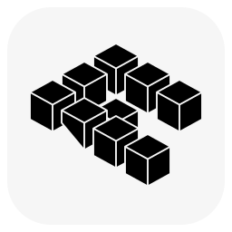

  

# GrimmDiff

**See the work behind the diff.**

A change rarely fits neatly into one file. GrimmDiff brings related Git changes together as work steps, explains each step in one sentence, and keeps the underlying code close at hand. It is a Windows desktop app for understanding what changed before you review it, share it, or return to it later.

[Download for Windows](https://github.com/Nephos-Bit/Bit.GrimmDiff/releases/latest) · [How it works](#from-changed-files-to-a-clear-story) · [Technical setup](docs/technical.md)

## From changed files to a clear story

A fix can touch a contract, its implementation, and a test. A file-by-file diff leaves you to piece that work together. GrimmDiff groups related sections into a single step with a short description, then lets you open each file's diff right there.

- **Understand your current work.** See staged, unstaged, and untracked changes together, organized by work step.
- **Revisit a commit.** Browse recent history and see how a past change fits together.
- **Stay close to Git.** Open or clone repositories, switch branches, and pull without leaving the app.

## Start locally. Go deeper when you choose.

GrimmDiff shows a local, rule-based analysis as soon as you open a change. For a more detailed grouping, you can run an optional analysis through the Codex CLI. The app asks for repository approval before sending diff sections to your signed-in ChatGPT workspace. Sensitive, binary, and oversized sections stay local and are still included in the local analysis.

The analysis can be shown in English or German. If Codex is unavailable, the local grouping remains usable.

## Get GrimmDiff

Download **GrimmDiff-Setup.exe** from the [latest release](https://github.com/Nephos-Bit/Bit.GrimmDiff/releases/latest). You need Windows 10 or later and [Git for Windows](https://git-scm.com/download/win). The [Codex CLI](https://developers.openai.com/codex/cli/) is only needed for optional AI analysis.

The installer enables in-app updates. Build instructions, portable packages, tests, and release steps are in the [technical guide](docs/technical.md).

GrimmDiff is released under the [MIT License](LICENSE). Bugs and ideas belong in [Issues](https://github.com/Nephos-Bit/Bit.GrimmDiff/issues).
