

  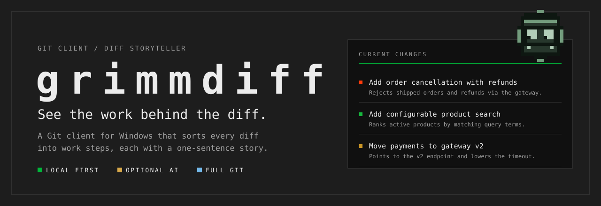

  <a href="https://github.com/Nephos-Bit/Bit.GrimmDiff/releases/latest"><b>Download for Windows</b></a>
  &nbsp;·&nbsp;
  <a href="#get-grimmdiff">Requirements</a>
  &nbsp;·&nbsp;
  <a href="docs/technical.md">Build from source</a>
  &nbsp;·&nbsp;
  <a href="https://github.com/Nephos-Bit/Bit.GrimmDiff/issues">Report an issue</a>

---

You touched eight files. Your reviewer sees eight files.
**GrimmDiff sees two pieces of work.**

GrimmDiff is a complete Git client for Windows with one extra talent: it reads your
diff the way a colleague would. Instead of an alphabetical wall of changed files, you get
**work steps**. Each step bundles the changes that belong together and explains itself in one
sentence. Review faster, commit with confidence, and never lose the thread of what you
actually built.

  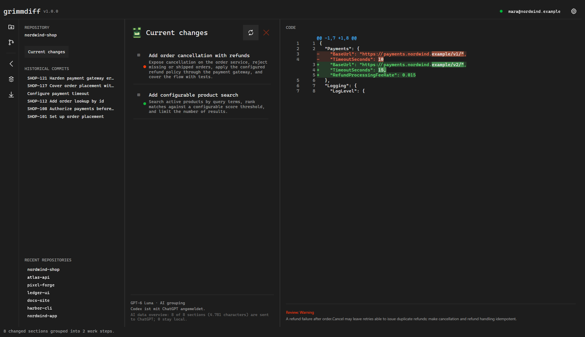

## Your diff, told as a story

  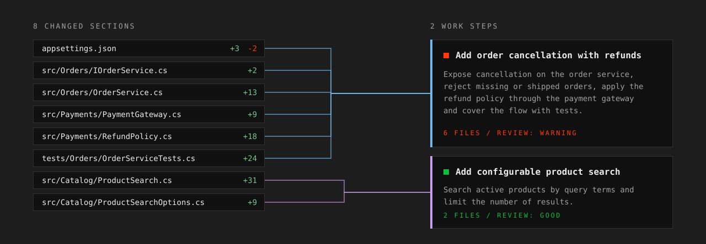

A new endpoint, its tests, a config tweak and a half-finished search feature, all in one
working tree? GrimmDiff untangles them. Changes are grouped by what they **do**, not by where
they live, so `OrderService.cs`, `RefundPolicy.cs` and their tests land in the same step,
while the product search gets its own.

- **One sentence per step.** Know what a change is about before you read a single line.
- **Click to dive in.** Expand a step to see its files, pick a file and read the diff with
  syntax colours right next to it.
- **Works on history too.** Open any past commit and read it as work steps.

## Know where to look first

  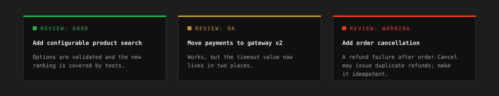

With AI grouping turned on, every work step also gets a quick review. A clear traffic light
shows you where you can relax and where you should take a second look. A short hint below
the code explains why, whether that is a missing test or a refund that could be issued twice.

## Instant on your machine. Smarter when you say so.

  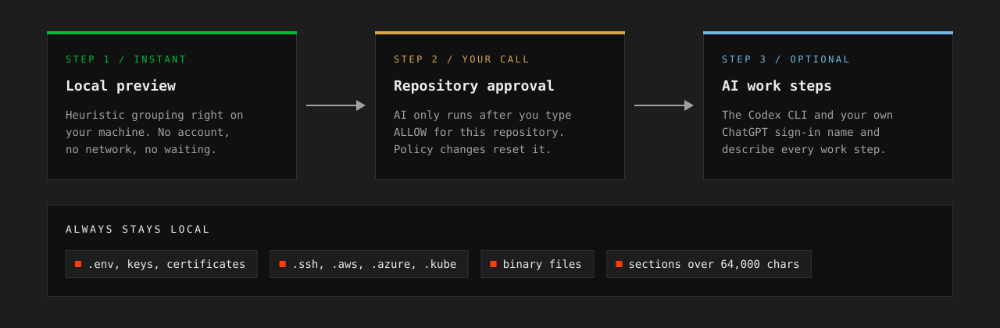

GrimmDiff is **local first**. The moment you open a repository, a built-in heuristic groups
your changes on your own machine. No account, no upload, no waiting.

When you want more, GrimmDiff can ask the [Codex CLI](https://developers.openai.com/codex/cli/)
using **your own ChatGPT sign-in** to name, describe and review each step. You stay in control:

- **Nothing leaves without your say.** AI analysis needs an explicit approval per repository,
  and you confirm it by typing `ALLOW`.
- **Approval with an expiry date.** If the repository configuration, the provider or the
  safety policy changes, GrimmDiff asks again.
- **Secrets stay home.** `.env` files, keys, certificates, credential stores, folders such as
  `.ssh` or `.aws`, binary files and oversized sections are never sent.
- **Full transparency.** GrimmDiff tells you upfront how many sections and characters would
  be transferred and how many stay local.

  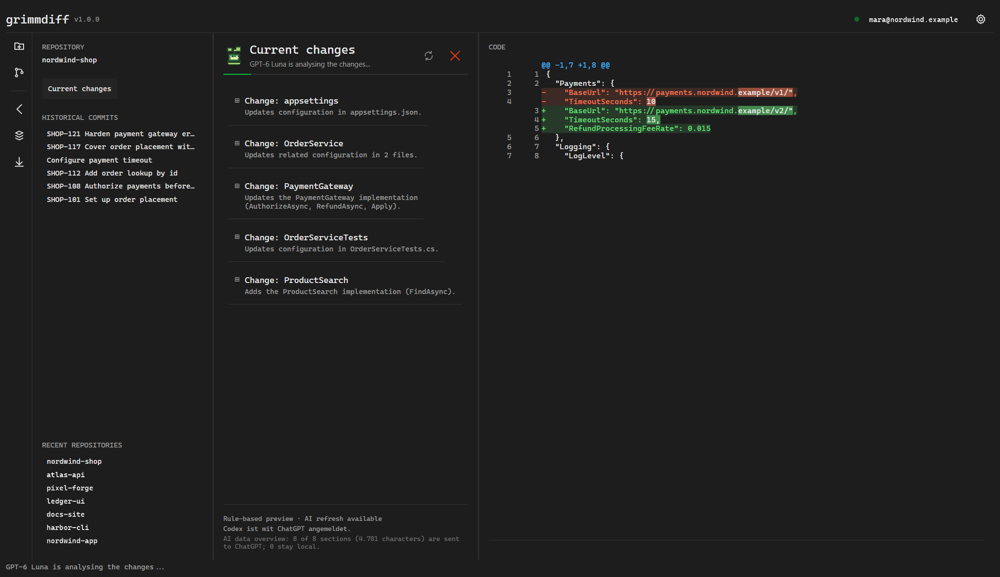
  &nbsp;
  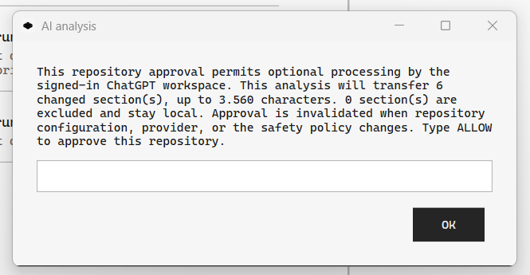

## Everything Git, without the terminal

  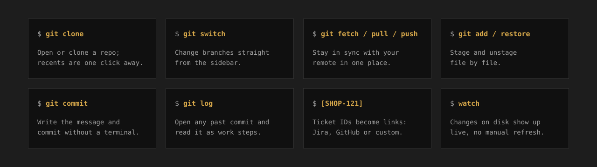

GrimmDiff is not a viewer bolted onto Git. It is a Git client for your daily work:

- **Open or clone** repositories and jump back to recent ones with one click.
- **Switch branches**, **fetch**, **pull** and **push** from the sidebar.
- **Stage, unstage and commit** file by file, then write your message in place.
- **Browse the history** and open any commit as work steps.
- **Ticket links.** IDs like `SHOP-121` in commit subjects become clickable links to Jira,
  GitHub or any tracker you describe with your own pattern.
- **Always fresh.** Changes on disk show up live, no manual refresh needed.

## Make it yours

  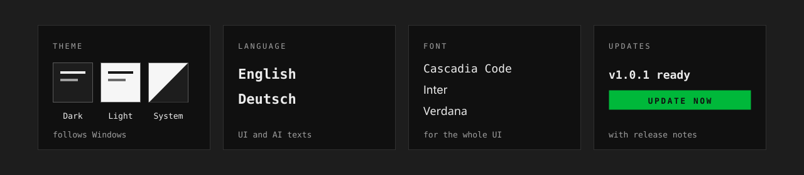

Dark, light or simply whatever Windows is using. English or German, for the interface and the
AI texts alike. Cascadia Code, Inter or Verdana for the whole UI. And when a new version is
out, GrimmDiff updates itself in place and shows you the release notes first.

  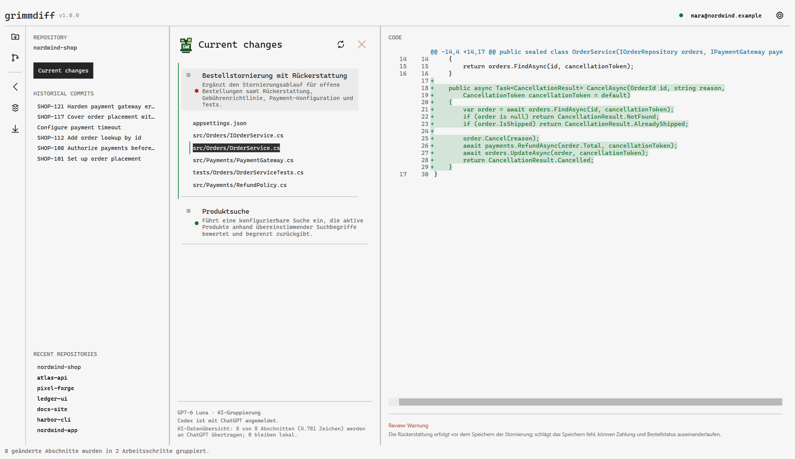

## Meet the crew

  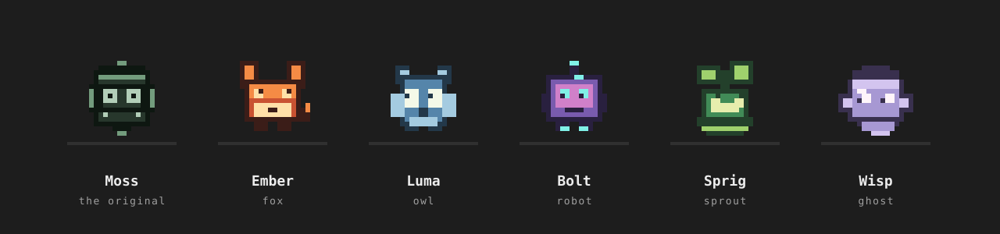

Every review is better with company. Pick your pixel companion in the settings: Moss the
original, Ember the fox, Luma the owl, Bolt the robot, Sprig the sprout or Wisp the ghost.
They blink, bob along, follow your mouse with their eyes and start scanning busily while the
AI works through your changes.

## Get GrimmDiff

1. Download **`GrimmDiff-Setup.exe`** from the
   [latest release](https://github.com/Nephos-Bit/Bit.GrimmDiff/releases/latest).
2. Make sure [Git for Windows](https://git-scm.com/download/win) is installed.
3. Open a repository and see the work behind your diff.

**Requirements:** Windows 10 or later and Git for Windows. For the optional AI work steps you
also need the [Codex CLI](https://developers.openai.com/codex/cli/) and a ChatGPT sign-in.

Want to build it yourself or contribute? The [technical guide](docs/technical.md) covers
building, testing and releasing. Found a bug or have an idea?
[Open an issue](https://github.com/Nephos-Bit/Bit.GrimmDiff/issues).

GrimmDiff is open source under the [MIT License](LICENSE).
